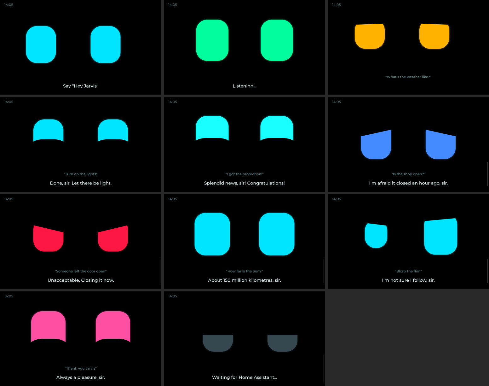
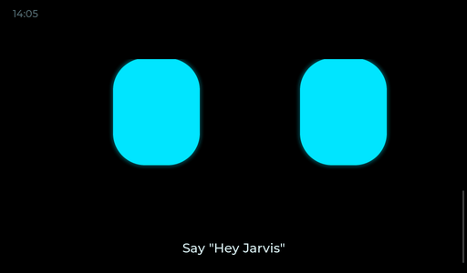

# J.A.R.V.I.S.: a personal AI assistant with a face

Say **"Hey Jarvis"** to the 7" Guition ESP32-P4 display. Its eyes wake up, listen, think and react
with emotions while it answers. It can:

- answer questions and look things up on the web
- control your smart home
- set timers
- look through a camera and tell you what it sees
- **create Home Assistant automations** for you
- **write ESPHome configs** for new devices

Everything is free: open-source software plus Google's free Gemini API tier.



<details><summary>Animation preview (idle, listening, thinking, happy reply)</summary>



</details>

The previews are rendered from the real face code (`jarvis_face.h`) with the same LVGL version the
display uses. The display font differs slightly from the preview font.

## How it fits together

```
 Display (ESP32-P4)              Raspberry Pi 4 (Home Assistant OS)        Mini PC (Docker)
 ─────────────────               ──────────────────────────────────        ────────────────
 "Hey Jarvis" wake word   ──▶    Voice pipeline "Jarvis"            ──▶    Whisper  (speech → text)
 mic + speaker                   Brain: Google Gemini (free tier)   ◀──    Piper    (text → voice)
 animated eyes + subtitles ◀──   Jarvis tools (jarvis_package.yaml):
 timers                            • set_mood     → face reacts
                                   • look         → camera + AI vision
                                   • create_automation
                                   • draft_esphome_config
                                   • web_search
                                 Your smart devices
 Camera: Pi Zero 2 W + camera module (or an ESP32-S3 camera board)
```

### Why this split

| | Where | Why |
|---|---|---|
| Wake word, face, timers | Display | Instant and offline |
| Speech-to-text and voice | **Mini PC** | Runs locally and privately. The i7 is 3-4x faster than the Pi 4 at this |
| Home Assistant | Pi 4 | Already running, so keep it |
| **Brain and vision** | Google Gemini, free tier | Writing automations and ESPHome configs and understanding photos needs a big AI model. On your hardware a local model would take 10-30 s per answer and make many mistakes |

**What about fully offline?** It's possible later. You'd need a desktop with an NVIDIA GPU, such as
a used RTX 3060 12 GB, running Ollama with a ~14B model and a vision model. Switching over means
changing two dropdowns in Home Assistant; nothing on the display changes. An optional slow
"private mode" is in `mini-pc/docker-compose.yml`.

**Pico and Zero 2 W:** the display's ESP32-P4 is far more powerful than a Pico, so the Pico isn't
needed here (keep it for sensors). The **Zero 2 W is useful as Jarvis's camera**, see step 6.

## Files

| File | What it is |
|------|------------|
| `jarvis.yaml` | ESPHome firmware for the display |
| `jarvis_face.h` | The animated eyes (blinking, glancing, 9 emotions) |
| `sounds/timer.wav` | Timer alarm |
| `secrets.example.yaml` | Copy to `secrets.yaml` and fill in your Wi-Fi details |
| `homeassistant/jarvis_package.yaml` | The Jarvis tools for Home Assistant |
| `mini-pc/docker-compose.yml` | Whisper and Piper for the mini PC |
| `camera-pi-zero/mediamtx.yml` | Turns a Pi Zero 2 W into a network camera |

---

## Step 1: Voice server on the mini PC

1. Install **Ubuntu Server 24.04** (or any Linux) on the mini PC, then Docker:
   `curl -fsSL https://get.docker.com | sh`
2. Copy the `mini-pc` folder to it and run `docker compose up -d` inside that folder.
   The first start downloads the models, which takes a few minutes.
3. In Home Assistant, go to **Settings → Devices & services → Add integration → Wyoming Protocol**:
   - host `<mini-PC-IP>`, port `10300` gives **Whisper**
   - add it again with port `10200`, which gives **Piper**

> Give the mini PC a fixed IP in your router so Home Assistant always finds it.
> If you want to skip the mini PC, install the **Whisper** (model `base-int8`) and **Piper** add-ons
> on the Pi 4 instead. That works, just a few seconds slower.

## Step 2: Gemini brain (free)

1. Get a free API key at https://aistudio.google.com/apikey (Google account, no card).
2. Go to **Add integration → Google Generative AI** and paste the key. Use a **Flash** model.
   This creates a conversation agent and an **AI Task** entity, which is used for camera vision.
3. **Settings → System → General → AI suggestions (AI Task):** set Google's AI Task entity as the default.
4. Open the conversation agent's options:
   - **Control Home Assistant:** Assist
   - **Instructions:**

```
You are J.A.R.V.I.S., a witty, loyal and highly capable British AI assistant. Call the user "sir".
Your answers are spoken aloud: keep them to 1-3 short sentences, no emojis, no markdown, no lists.

Before EVERY reply, call "Jarvis set mood" with the emotion that fits your reply
(happy when something worked, sad for bad news, surprised for amazing facts, confused if
you didn't understand, excited for good news, love when thanked, angry only playfully).

Tools:
- Smart home: control and check exposed devices directly.
- "Jarvis look": whenever the user asks what you see / what this is / to read or look at something.
- "Jarvis web search": for news, prices, weather details, opening hours, recent events,
  or anything you are not sure about. Never invent facts.
- "Jarvis create automation": when asked to automate something. FIRST explain in one sentence
  what the automation will do and ask "Shall I create it?". Only call the tool after the user
  says yes. Start the alias with "[Jarvis] ".
- "Jarvis draft ESPHome config": when asked to make or set up an ESPHome device. Say it was sent
  to Home Assistant, and explain any wiring briefly. Never read YAML aloud.
- Timers, shopping list and to-do lists: use the built-in tools.
```

### Web search agent (optional)

The Gemini integration has a **Google Search** option, but in Home Assistant it can't be combined
with smart-home control in the same agent. So add a **second** agent just for searching:

1. On the Google Generative AI integration, click **Add conversation agent** (or add the integration
   again) and name it **Jarvis Search**.
2. In its options, turn **Control Home Assistant off** and turn **Enable Google Search tool on**.
3. Note its entity ID, e.g. `conversation.jarvis_search`, and put it in `jarvis_package.yaml`
   (line marked `# <-- CHANGE`).

If your Home Assistant version doesn't show the Google Search option, skip this. Jarvis then answers
from Gemini's own knowledge.

## Step 3: The "Jarvis" assistant

Go to **Settings → Voice assistants → Add assistant**:

| Setting | Value |
|---|---|
| Name | Jarvis |
| Language | English |
| Conversation agent | Google Generative AI (the one with Assist control) |
| Prefer handling commands locally | **On**, so "turn on the lights" is instant and free |
| Speech-to-text | faster-whisper (mini PC) |
| Text-to-speech | piper, voice `en_GB-alan-medium` |

Star it as the **preferred** assistant.

## Step 4: Jarvis tools package

1. In Home Assistant, install the **File editor** or **Studio Code Server** add-on.
2. Add this to `/config/configuration.yaml`, if it isn't there already:
   ```yaml
   homeassistant:
     packages: !include_dir_named packages
   ```
3. Copy `homeassistant/jarvis_package.yaml` to `/config/packages/jarvis_package.yaml`.
4. Create a token under **Profile → Security → Long-lived access tokens → Create token** (name it
   "Jarvis"), then add it to `/config/secrets.yaml`:
   ```yaml
   jarvis_ha_token: "Bearer PASTE_THE_TOKEN_HERE"
   ```
5. Go to **Developer tools → YAML → Check configuration**, then **Restart**.
6. **Expose the tools:** **Settings → Voice assistants → Expose → + Expose entities**, then tick the 5
   `Jarvis ...` scripts. While you're there, expose the lights, switches, climate and media players
   you want Jarvis to control.

> **Safety:** Jarvis can only touch what you expose. New automations always start with
> **[Jarvis]**, so you can find and delete them under Settings → Automations. Jarvis asks before
> creating one. ESPHome configs are only *sent to you*; you decide whether to install them.

## Step 5: Flash the display

1. Install the **ESPHome Device Builder** add-on on the Pi.
2. Copy `jarvis.yaml`, `jarvis_face.h` and the `sounds` folder into `/config/esphome/`.
3. Put your Wi-Fi details in the ESPHome **Secrets** (top-right menu), following
   `secrets.example.yaml`.
4. First flash over USB: connect the display to the computer running your browser, using the
   **Full-speed Type-C** port (#7), then **Install → Plug into this computer**.
   Later updates go over Wi-Fi.
5. Home Assistant discovers **Jarvis**. Click **Configure**.
6. Open the device page (**Settings → Devices → Jarvis**):
   - **Assistant:** Jarvis
   - Allow the device to perform Home Assistant actions: not needed
   - Try the **Face Mood** dropdown and watch the eyes change.

## Step 6: Give Jarvis an eye (camera)

The display's built-in camera can't be used yet: ESPHome doesn't support this kind of camera (MIPI-CSI)
on the ESP32-P4. Use one of these and mount it next to the display:

**A) Your Raspberry Pi Zero 2 W + Camera Module 3 (about 10 OMR)**
1. Flash **Raspberry Pi OS Lite (64-bit)** and plug in the camera.
2. Download **MediaMTX** for `linux_arm64` from https://github.com/bluenviron/mediamtx/releases,
   and merge the `paths:` section from `camera-pi-zero/mediamtx.yml` into its `mediamtx.yml`.
3. Run it (or install it as a service, as described in the MediaMTX README).
4. In Home Assistant, go to **Add integration → Generic Camera**, set the stream to
   `rtsp://<zero-ip>:8554/jarvis_eye`, and name the camera **jarvis_eye**.

**B) An ESP32-S3 camera board (about 4 OMR):** flash it with ESPHome's `esp32_camera` component and
name the camera `jarvis_eye`.

Then make sure `camera_entity` in `jarvis_package.yaml` matches, e.g. `camera.jarvis_eye`.

Try: *"Hey Jarvis, what am I holding?"* or *"Hey Jarvis, read this label."*

---

## Things to say

| You say | Jarvis does |
|---|---|
| "Turn off all the lights" | Controls devices instantly, handled locally |
| "Set a timer for 10 minutes" | Starts a timer on the display; it beeps and the face reacts when done |
| "What's the weather tomorrow?" | Uses your Home Assistant weather entity |
| "Who won the match last night?" | Web search |
| "What is this?" | Takes a photo and describes it |
| "Turn on the porch light every day at sunset" | Explains it, asks "Shall I create it?", then creates the automation |
| "Make me an ESPHome config for a DHT22 on an ESP32, pin 4" | Sends the full YAML and wiring notes to Home Assistant |
| "Add milk to the shopping list" | Built-in to-do list |
| "Explain how transformers work in AI" | General knowledge |

Tap the face to talk without the wake word. Tap again to stop. Tap a ringing timer to silence it.

## Troubleshooting

| Problem | Fix |
|---------|-----|
| Won't boot; log says `chip revision: v1.x` | Add `engineering_sample: true` under `esp32:` |
| No Wi-Fi | The ESP32-C6 Wi-Fi chip may need a firmware update (see the `esp32_hosted` docs), or use Ethernet |
| Eyes stay grey ("Waiting for Home Assistant") | The device isn't adopted yet, or the API key doesn't match |
| Face never shows moods | The `Jarvis set mood` script isn't exposed, or the instructions are missing. Jarvis still guesses a mood from its reply |
| "Jarvis look" fails | Check the camera entity name, and that Google's AI Task entity is the default |
| Automation not created | Check `jarvis_ha_token` starts with `Bearer `. If your Home Assistant uses SSL, change the URL in the package to `https://` |
| Slow answers | Check that Whisper runs on the mini PC, not the Pi. Use a Gemini **Flash** model |
| Animation is choppy | Lower `GLOW` in `jarvis_face.h` (e.g. 0), or set the `interval:` in `jarvis.yaml` to 50ms |
| Wake word too sensitive or deaf | Change `mic_gain` in `audio_dac:` (18DB-30DB) |

## Customising the face

All in `jarvis_face.h`:
- Eye size and position: `EYE_W`, `EYE_H`, `EYE_SPACING`, `EYE_CY`
- Colours: `mood_color()`
- Emotion shapes: `target_shape()`
- How long an emotion stays after speaking: `EMOTION_HOLD_MS`

## Credits

- Hardware pin mapping: [p1ngb4ck/unofficial_guition_esp32p4_repo](https://github.com/p1ngb4ck/unofficial_guition_esp32p4_repo/tree/main/JC1060P470_I_W_Y)
- [ESPHome voice assistant](https://esphome.io/components/voice_assistant/), [micro_wake_word](https://esphome.io/components/micro_wake_word/), [LVGL](https://esphome.io/components/lvgl/)
